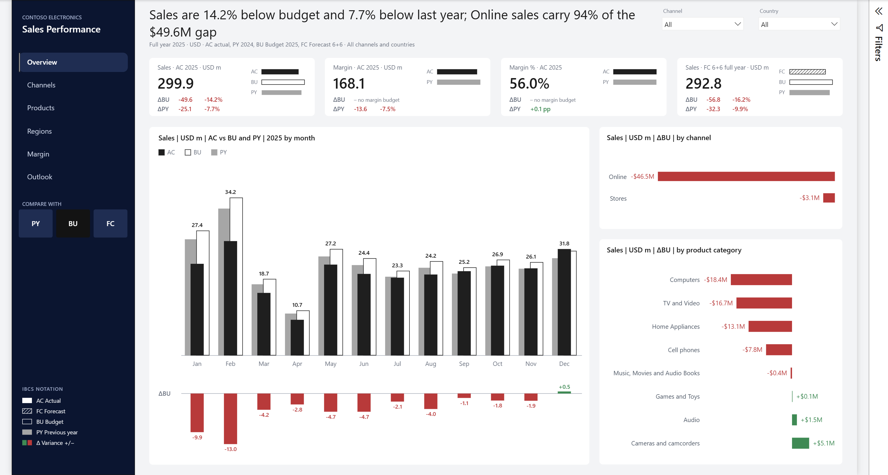
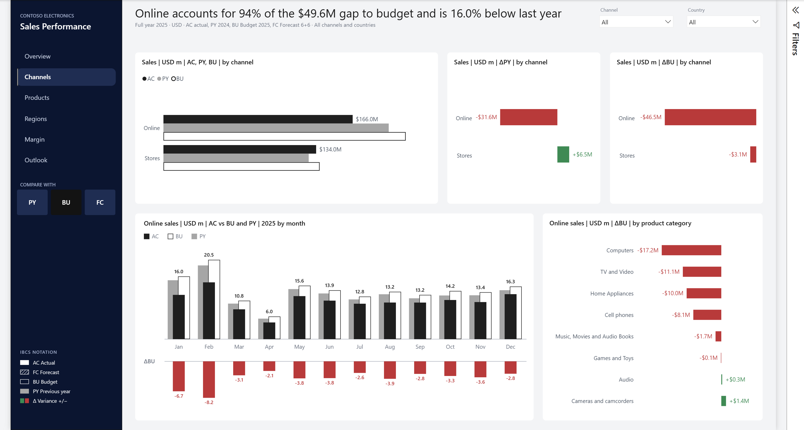
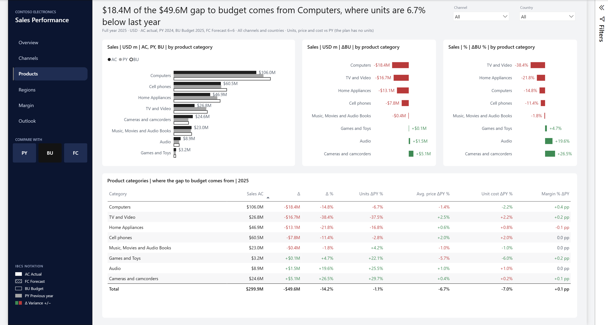
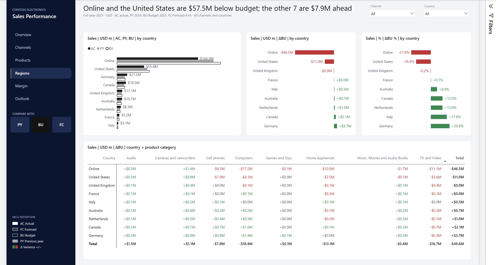
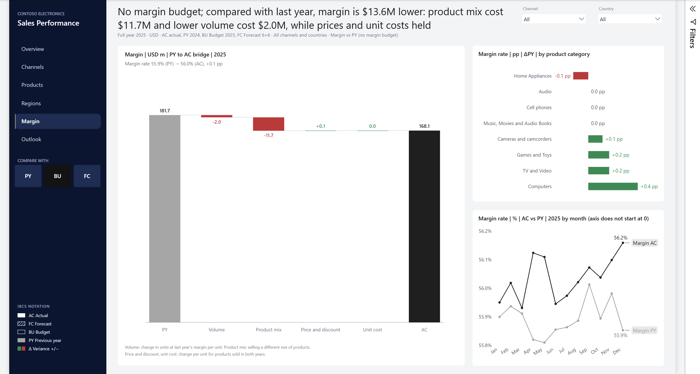
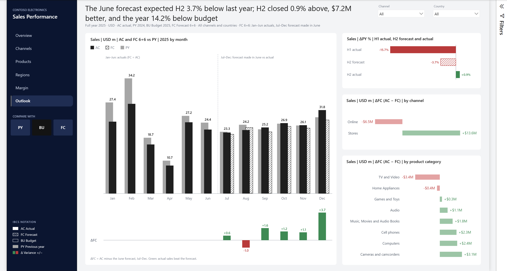
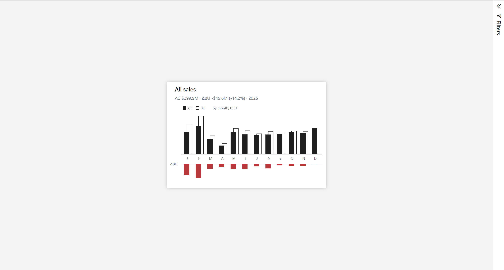

# Code-First Power BI: Semantic Model and IBCS Report Built with Claude Code and SQL Server

Built and validated an end-to-end Power BI solution on 2.35M SQL Server rows with Claude Code: a star schema with calculation groups and an IBCS Actual vs. Budget/Forecast report, with every measure reconciled to source.

<table>
  <tr>
    <td> <b>Channels</b>: Online vs. stores, and where each channel's gap comes from</td>
    <td> <b>Products</b>: gap by category, with a driver table of units, price, cost and margin</td>
  </tr>
  <tr>
    <td> <b>Regions</b>: gap by country, and a country × category variance matrix</td>
    <td> <b>Margin</b>: PY-to-AC margin bridge (volume, mix, price, unit cost)</td>
  </tr>
  <tr>
    <td> <b>Outlook</b>: the June forecast (6+6) against what H2 delivered</td>
    <td> <b>Tooltip</b>: a report-page tooltip on every chart, table and matrix</td>
  </tr>
</table>

The headline in 2025: sales of $299.9M came in $49.6M (14.2%) below budget, and the online store accounts for $46.5M of that gap. Every page title is a DAX measure that states the finding and updates with the filters and the Compare with switch (PY, BU or FC).

## What's inside

| Part | What it is |
|---|---|
| **SQL** | 9 views in schema `model` over SQL Server 2022 (`sql/`). All data preparation happens here, including the 2025 budget and forecast, which the source doesn't have. All SQL work runs on a least-privilege login that can read data and create views, nothing else. |
| **Semantic model** | TMDL in `Contoso Sales.SemanticModel/`, all Import. 9 tables, 48 columns, 7 relationships, 3 of them many-to-many joins from the monthly plan to day, product and store, protected by a grain guard. 81 measures (29 for users, 52 report helpers hidden from the field list) and 2 calculation groups (Scenario: AC, PY, BU, FC and their variances; Time: MTD, QTD, YTD) with 14 items. |
| **Report** | PBIR in `Contoso Sales.Report/`, generated by `tools/build_report.mjs`. 6 pages plus a tooltip page, 126 visuals, IBCS notation (solid AC, grey PY, outlined BU, hatched FC, red and green variances), and SVG KPI tiles and charts drawn by DAX measures. |
| **Tests** | 13 DAX tests (T1–T12, plus T8b) in `tests/dax_tests.dax`, each matched by a SQL query on the source tables in `tests/sql_expected.sql`. All values match to the cent. `tools/validate_pbip.py` runs 1,343 checks on the model and report wiring. |
| **AI readiness** | A description on every table, column, measure and calculation item; 117 synonyms on 54 objects in the en-US culture with no duplicates; keys and default labels; report-only measures hidden; and a ready-to-paste Prep data for AI draft (`_brief/prep-data-for-ai.md`) with AI instructions, a schema selection and five verified answers. |
| **Docs** | [docs/contoso-sales.md](docs/contoso-sales.md), also as [Word](docs/contoso-sales.docx): data source, model diagrams, measures, every page, validation and lessons learned. |

## Stories

**The currency that wasn't there.** The first project rules said prices were in each order's local currency and needed converting. Checking 336,322 product-days showed the same price in every currency, so the amounts were already USD and the conversion was overstating 2024 sales by $14M. [More in 8.1](docs/contoso-sales.md#81-the-currency-correction)

**Timeouts that weren't the query.** A refresh failed with SQL timeouts. The DMVs showed no blocking but memory grants of 59 MB and 74 MB waiting 356 seconds, with SQL Server using only 157 MB and Windows down to 834 MB free: the laptop was starved of memory, not the query. Closing heavy apps and setting a minimum server memory fixed it with no query changes. [More in 8.3](docs/contoso-sales.md#83-refresh-timeouts-traced-to-os-memory-starvation)

**Margin fell on mix, not price.** Gross margin dropped $13.6M against last year, but the margin rate rose 0.1 pp. The bridge measures show why: product mix cost $11.7M and lower volume $2.0M, while price and unit cost held. [More in 4.1](docs/contoso-sales.md#41-measure-families) and [5.7](docs/contoso-sales.md#57-margin)

## How it was built

This project was built with Claude Code in VS Code under my direction, using the [powerbi-authoring plugin](https://github.com/microsoft/skills-for-fabric) from microsoft/skills-for-fabric. It followed Ilya Fedorkov's plan-first method: an outcome-based request, a plan approved before any build, then a render → screenshot → review → fix loop. The report's IBCS design follows the reference design from his video walkthrough.

- **Claude** wrote the SQL views, the TMDL model, the PBIR report generator, the validators, the tests and the documentation.
- **I** reviewed and approved every plan, made the design decisions, ran Power BI Desktop and the click tests, and caught the visual issues.

Data: SQLBI's [Contoso Data Generator V2](https://github.com/sql-bi/Contoso-Data-Generator-V2-Data/releases/tag/ready-to-use-data), the `bak-ContosoV2-1M` backup, restored as `Contoso1M`.

## Rebuild it

You need SQL Server 2022, Power BI Desktop, [uv](https://docs.astral.sh/uv/) and Node.js.

1. Restore the SQLBI backup as `Contoso1M`, create the `claude_reader` login and the `model` schema, and set `CLAUDE_SQL_PWD` (script in [docs, section 1](docs/contoso-sales.md#1-overview)).
2. Create the views: `uv run tools/sql.py -f sql/model_dims.sql`, then `model_sales.sql`, `model_plan.sql` and `model_report.sql`.
3. Generate and check the report: `node tools/build_report.mjs`, then `uv run tools/validate_pbip.py`.
4. Open `Contoso Sales.pbip` in Power BI Desktop and refresh.
5. Run `tests/dax_tests.dax` in DAX query view and compare with `uv run tools/sql.py -f tests/sql_expected.sql`.

## License

The code and documentation are under the [MIT License](LICENSE). The Contoso dataset is SQLBI's and keeps its own licence; see [their repository](https://github.com/sql-bi/Contoso-Data-Generator-V2-Data). This repository contains no data from it, only the SQL that reads it, screenshots and test values.
