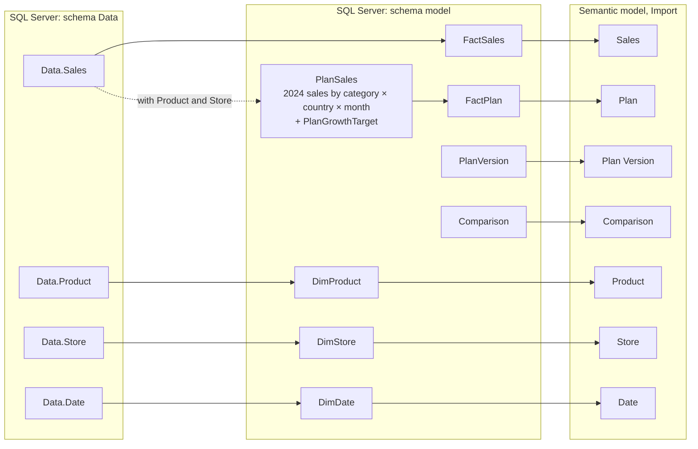
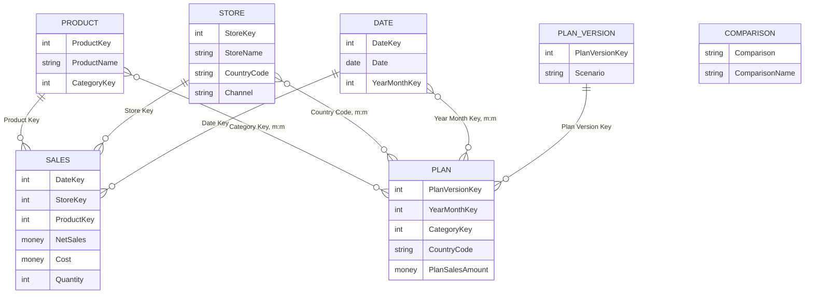
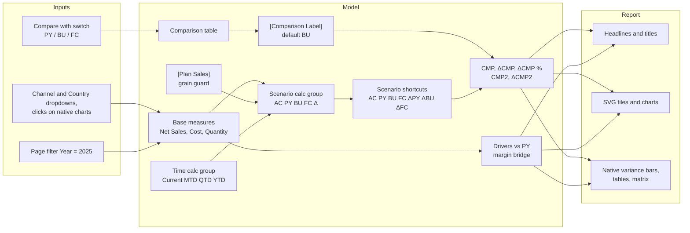
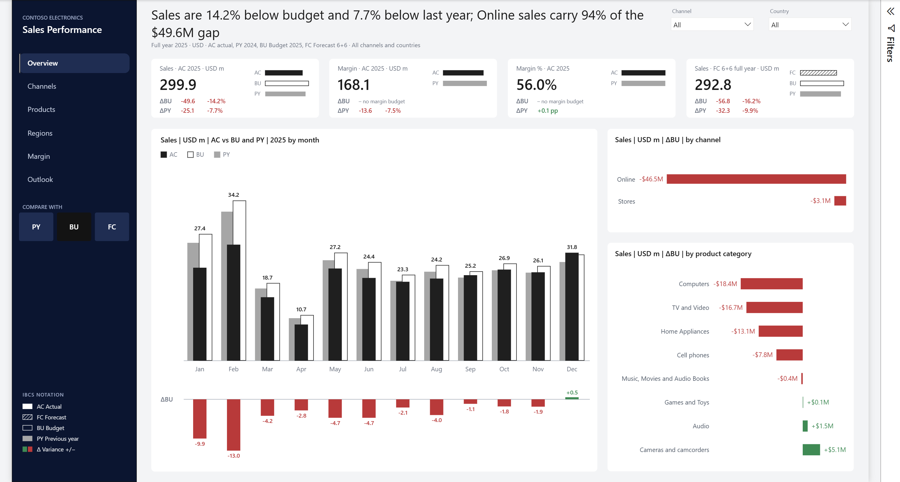
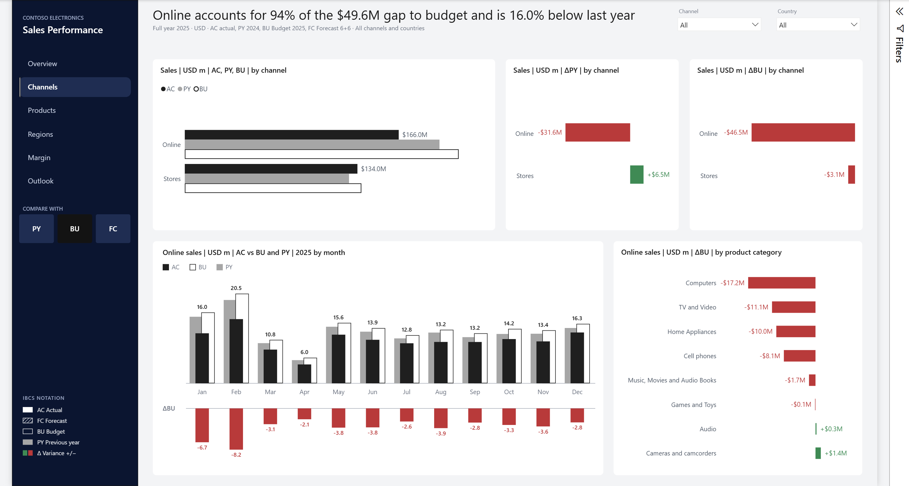
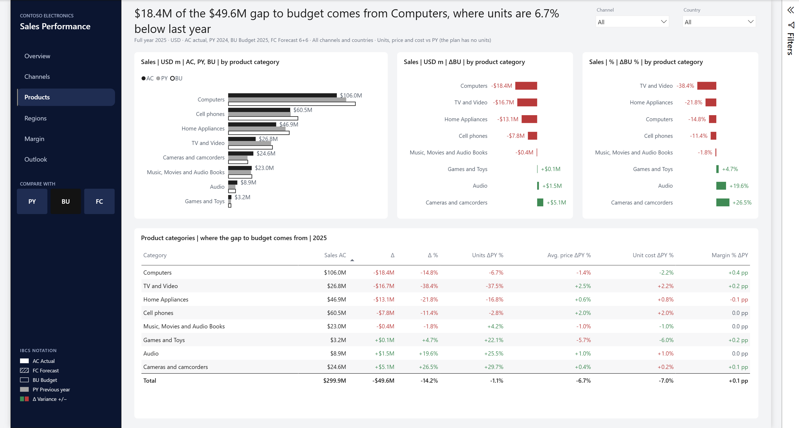
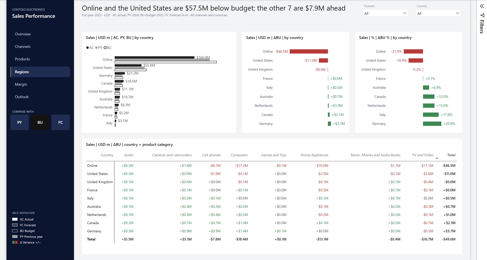
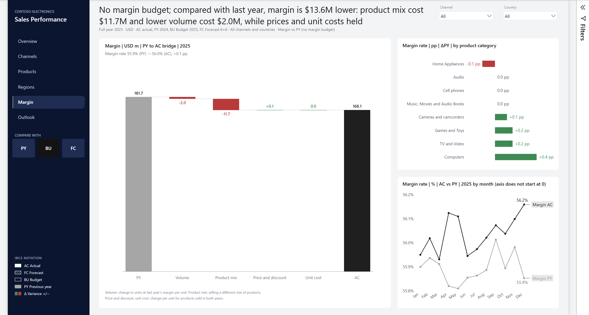
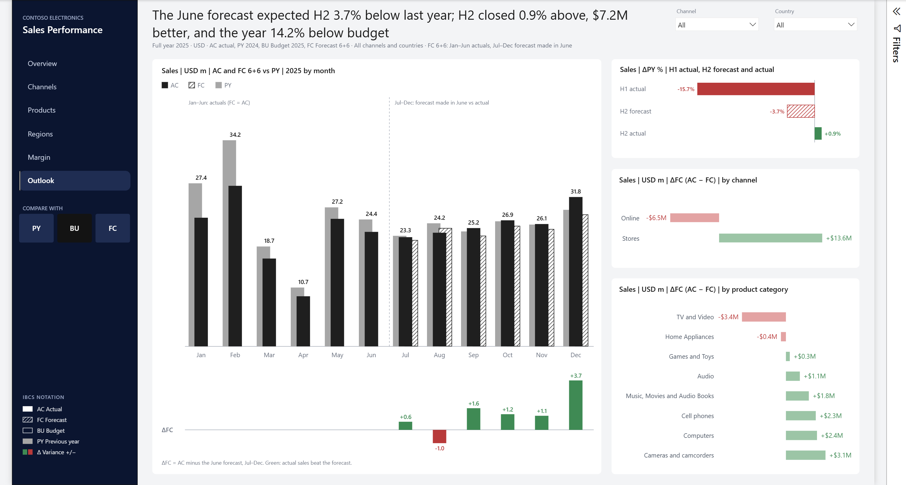
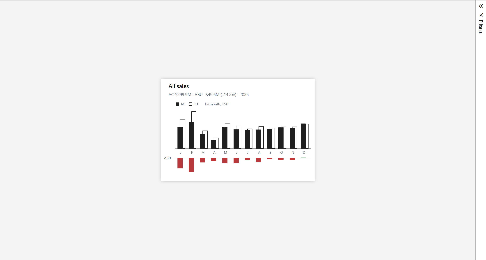

# Contoso Sales Performance: model and report

Documentation for the Contoso Sales Power BI project: the SQL views, the semantic model, the six-page IBCS leadership report, AI readiness, validation and lessons learned. The Word version, `contoso-sales.docx`, has the same content; `tools/build_docs.py` builds it from this file.

Contents:
1. Overview
2. Data source
3. Semantic model
4. Measures and calculation groups
5. Report
6. AI readiness
7. Validation
8. Lessons learned
9. Appendix

## 1. Overview

**Contoso** is a fictional electronics retailer that sells through physical stores in eight countries and through one online store. This project gives its leadership a full-year 2025 view of sales against last year (PY), budget (BU) and forecast (FC), and explains where the gaps come from. The report uses IBCS notation.

Everything is built as code in this repository and opened in Power BI Desktop as a PBIP project:

| Folder or file | What it holds |
|---|---|
| `sql/` | The views in schema `model`: dimensions, sales fact, plan (budget and forecast), and the Compare with list |
| `Contoso Sales.SemanticModel/` | The semantic model as TMDL: tables, relationships, measures, calculation groups, the en-US culture with synonyms |
| `Contoso Sales.Report/` | The report as PBIR, generated by `tools/build_report.mjs` |
| `Contoso Sales.pbip` | The project file Desktop opens |
| `tools/` | `sql.py` (queries), `build_report.mjs` (report generator), `validate_pbip.py` (model and report checks), `build_docs.py` (this document's Word version) |
| `tests/` | `dax_tests.dax` (T1–T12) and `sql_expected.sql` (the same numbers from SQL) |
| `_brief/` | The report spec as built, the reference design, Prep data for AI draft, screenshots |
| `docs/` | This documentation |

**Rebuilding from scratch:**

0. One-time setup, as a SQL Server administrator: restore the backup as `Contoso1M` (source in 2.1), then run the script below to create the `claude_reader` login with the permissions in 2.2 and the empty `model` schema. The login uses SQL Server authentication, so the instance must allow it (mixed mode). Finally set the `CLAUDE_SQL_PWD` environment variable to the login's password, for example `setx CLAUDE_SQL_PWD "<password>"`, and open a new terminal; `tools/sql.py` reads it.
1. Run the SQL scripts: `uv run tools/sql.py -f sql/model_dims.sql`, then `model_sales.sql`, `model_plan.sql` and `model_report.sql`.
2. Generate the report: `node tools/build_report.mjs`.
3. Validate: `npx -y @microsoft/powerbi-report-authoring-cli validate "Contoso Sales.Report"` and `uv run tools/validate_pbip.py`.
4. Open `Contoso Sales.pbip` in Desktop and refresh.
5. Run `tests/dax_tests.dax` in DAX query view and compare with `uv run tools/sql.py -f tests/sql_expected.sql`.

Setup script for step 0:

```sql
USE master;
CREATE LOGIN claude_reader WITH PASSWORD = '<choose a strong password>';
GO
USE Contoso1M;
CREATE USER claude_reader FOR LOGIN claude_reader;
ALTER ROLE db_datareader ADD MEMBER claude_reader;
GRANT CONNECT, CREATE VIEW, VIEW DEFINITION TO claude_reader;
GO
CREATE SCHEMA model AUTHORIZATION dbo;
GO
GRANT ALTER ON SCHEMA::model TO claude_reader;
```

### 1.1 How this was built

The project was built with Claude Code (Claude Opus 5.5) in VS Code, using the powerbi-authoring plugin (version 0.3.19) from [microsoft/skills-for-fabric](https://github.com/microsoft/skills-for-fabric). The plugin's skills cover report planning and design, PBIR and semantic-model authoring, validation, and the Desktop preview and screenshots used here.

The work followed Ilya Fedorkov's plan-first method: a short request that states the outcome; a plan with the story in the data, a page plan and the decisions to confirm, approved before anything is built; then a render → screenshot → review → fix loop until every page looks right. The report's IBCS design follows the reference design from his video walkthrough, summarised in `_brief/reference-design-spec.md`.

| Who | Did |
|---|---|
| Claude | Wrote the SQL views, the TMDL semantic model, the PBIR report (through `tools/build_report.mjs`), the validators, the DAX and SQL tests, and this documentation |
| Yogesh (project owner) | Reviewed and approved every plan, made the design decisions, ran Power BI Desktop and the click tests, and caught the visual issues |

## 2. Data source

### 2.1 Database and views

The data lives in SQL Server 2022 on `localhost`, database `Contoso1M`. The source tables are in schema `Data`. All data preparation happens in views in schema `model`; the semantic model reads those views and nothing else, with no Power Query steps.

The data is SQLBI's Contoso Data Generator V2 sample: the `bak-ContosoV2-1M` backup from its [ready-to-use-data release](https://github.com/sql-bi/Contoso-Data-Generator-V2-Data/releases/tag/ready-to-use-data), restored and renamed to `Contoso1M`.

**Source tables (schema `Data`):**

| Table | Rows | Used for |
|---|---:|---|
| Sales | 2,349,091 | Order lines: date, store, product, quantity, prices, unit cost |
| OrderRows | 2,349,091 | Not used (Sales already holds the lines) |
| Orders | 980,666 | Not used |
| Customer | 86,908 | Not used |
| Product | 2,517 | Product, brand, subcategory, category |
| Store | 74 | Stores, including the online store (StoreKey 999999, CountryCode `--`) |
| Date | 4,018 | Calendar |
| CurrencyExchange | 100,450 | Not used (amounts are already USD, see 8.1) |

**Model views (schema `model`):**

| View | Rows | Grain and purpose | Model table |
|---|---:|---|---|
| DimDate | 3,653 | One row per day, 2016–2025 | Date |
| DimProduct | 2,517 | One row per product | Product |
| DimStore | 74 | One row per store; the online store becomes Country Code `ONL`, Country `Online`, Channel `Online` | Store |
| FactSales | 2,121,514 | Day × store × product; quantity, net sales (quantity × net price) and cost (quantity × unit cost) in USD | Sales |
| PlanGrowthTarget | 8 | Budget growth target per category, 2025 vs 2024 | (input to PlanSales) |
| PlanSales | 1,728 | BU and FC 2025 by month × category × country, with helper columns | (input to FactPlan) |
| FactPlan | 1,728 | The same rows with only the columns the model uses | Plan |
| PlanVersion | 2 | BU and FC | Plan Version |
| Comparison | 3 | PY, BU, FC for the report's Compare with switch | Comparison |

Diagram 1 shows how the source tables flow through the views into the model:



### 2.2 Least-privilege login

Every query in this project, including the SQL tests, runs as the SQL login `claude_reader`, checked with a permissions query:

| Check | Result |
|---|---|
| Server role sysadmin | No |
| Database roles | db_datareader only (not db_owner, db_datawriter or db_ddladmin) |
| Database permissions | CONNECT, SELECT, CREATE VIEW, and the VIEW DEFINITION family |
| Schema `Data` | SELECT, VIEW DEFINITION |
| Schema `model` | SELECT, ALTER (so it can create and change views there), VIEW DEFINITION |
| `Data.Sales` | Can select; cannot insert, update or delete |

So the login can read everything and build views in `model`, but it can't change data or touch objects outside `model`.

### 2.3 Why the plan is built in SQL

The source has no budget or forecast, so the plan is derived from actuals in `sql/model_plan.sql`:

- **BU (budget 2025)** = the 2024 net sales of each category × country × (1 + the category's growth target), spread over the months by the category's 2024 monthly pattern. The growth targets are 3–12% (view `PlanGrowthTarget`).
- **FC (forecast 6+6)** = January to June 2025 actuals, plus a July to December forecast that closes half of the first-half gap to budget for each category × country.

Building it in SQL rather than in DAX or Power Query keeps the rule in one reviewable place and lets the SQL tests compute the same numbers. It also means the plan is a small static table: 2 versions × 12 months × 8 categories × 9 countries = 1,728 rows. That's why it is Import (see 8.2).

## 3. Semantic model

### 3.1 Tables

| Table | Kind | Rows | Notes |
|---|---|---:|---|
| Sales | Fact (actuals) | 2.1M | Measures live here; the amount columns are hidden |
| Plan | Fact (plan) | 1,728 | Hidden; used only through the BU and FC measures |
| Date | Dimension | 3,653 | Marked as the date table |
| Product | Dimension | 2,517 | Product > Subcategory > Category, plus Brand |
| Store | Dimension | 74 | Store > State > Country > Channel |
| Plan Version | Dimension | 2 | Hidden; BU and FC |
| Comparison | Disconnected | 3 | Hidden; feeds the Compare with switch |
| Scenario | Calculation group | 10 items | AC, PY, BU, FC and their variances |
| Time | Calculation group | 4 items | Current, MTD, QTD, YTD |

All tables are in Import mode.

### 3.2 Relationships

Diagram 2 shows the relationships. Dimensions filter facts in one direction.



**Many-to-many plan joins.** The plan exists per month × category × country, but the dimensions are per day, product and store. Rather than add bridge tables, Plan joins each dimension on the shared attribute: Date on `Year Month Key`, Product on `Category Key` and Store on `Country Code`. These are many-to-many relationships with the dimension filtering the plan. Channel needs no join of its own, because each country belongs to one channel (Online is the country `ONL`).

**Grain guard.** A many-to-many join would also let a single store or a single day "see" the whole budget of its country or month, which would be wrong. The hidden measure `Plan Sales` therefore returns the plan only when the filter covers whole months, whole categories and whole countries:

```dax
VAR _isWholeMonths =
    COUNTROWS ( 'Date' )
        = CALCULATE ( COUNTROWS ( 'Date' ),
            REMOVEFILTERS ( 'Date' ), VALUES ( 'Date'[Year Month Key] ) )
VAR _isWholeCategories =
    COUNTROWS ( 'Product' )
        = CALCULATE ( COUNTROWS ( 'Product' ),
            REMOVEFILTERS ( 'Product' ), VALUES ( 'Product'[Category Key] ) )
VAR _isWholeCountries =
    COUNTROWS ( 'Store' )
        = CALCULATE ( COUNTROWS ( 'Store' ),
            REMOVEFILTERS ( 'Store' ), VALUES ( 'Store'[Country Code] ) )
RETURN
    IF ( _isWholeMonths && _isWholeCategories && _isWholeCountries,
        SUM ( 'Plan'[Plan Sales Amount] ) )
```

Test T7 checks it: the 2025 budget has values by category, country, channel and month, and is blank by brand, store, day and working day.

## 4. Measures and calculation groups

### 4.1 Measure families

| Family | Measures | Notes |
|---|---|---|
| Base | Net Sales, Sales Quantity, Cost, Gross Margin, Gross Margin % | Net Sales = quantity × net price in USD |
| Scenario shortcuts | AC, PY, BU, FC, ΔPY, ΔPY %, ΔBU, ΔBU %, ΔFC, ΔFC % | Net Sales with one Scenario item applied, so visuals can show scenarios side by side |
| Drivers vs PY | Avg Net Price, Avg Unit Cost, Units ΔPY %, Avg Net Price ΔPY %, Avg Unit Cost ΔPY %, Gross Margin PY, Gross Margin ΔPY, Gross Margin ΔPY %, Gross Margin % PY, Gross Margin % ΔPY pp | Compared with PY because the plan has no units or cost |
| Margin bridge | Margin Volume Effect, Margin Mix Effect, Margin Price Effect, Margin Unit Cost Effect | PY to AC at product grain; the four add up to Gross Margin ΔPY |
| Comparison (report only) | CMP, ΔCMP, ΔCMP %, CMP2, ΔCMP2, ΔCMP2 %, ΔCMP Focus Channel | Follow the Compare with switch |
| Report text and visuals (report only) | Headlines, subtitles, titles, tooltip text, 11 SVG measures | Hidden from the field list and from Copilot |

Every measure has a description, a display folder and, unless it returns text or an image, a format string.

**Margin bridge.** The bridge splits the gross margin change into four effects, computed per product:
- **Volume:** the change in units, valued at last year's average margin per unit.
- **Price:** for products sold in both years, this year's units × the change in net price per unit.
- **Unit cost:** the same for cost per unit, negated so that higher costs are negative.
- **Mix:** the rest of the change, which is the effect of selling a different mix of products, including new and dropped products.

In 2025 list prices and unit costs per product didn't change, so the whole \$13.6M drop is volume (−\$2.0M) and mix (−\$11.7M).

### 4.2 Calculation groups

**Scenario** (precedence 20) applies a scenario to any measure:

| Item | Meaning |
|---|---|
| AC | Actual, the measure as recorded |
| PY | Previous year: the same period one year earlier |
| BU | Budget 2025, Net Sales only, through the grain guard |
| FC | Forecast 6+6, Net Sales only, through the grain guard |
| ΔPY, ΔPY% | AC − PY, and (AC − PY) / PY |
| ΔBU, ΔBU% | AC − BU, and (AC − BU) / BU; Net Sales only |
| ΔFC, ΔFC% | AC − FC, and (AC − FC) / FC; Net Sales only |

**Time** (precedence 10) gives Current, MTD, QTD or YTD for any measure. Because Scenario has the higher precedence, it is applied outside Time:
- **YTD + PY** is last year's year to date.
- **YTD + ΔBU** is the year-to-date gap to budget.

Test T5 checks these combinations.

### 4.3 The Compare with switch

The report's Compare with switch (PY | BU | FC) is a slicer on the disconnected Comparison table. Measures read the selection, so every visual keeps cross-filtering normally:

- `Comparison Label` = the selected code, BU when nothing is selected.
- `CMP`, `ΔCMP`, `ΔCMP %` switch to the PY, BU or FC measures.
- `CMP2` is the second comparison shown next to it: PY when BU or FC is chosen, BU when PY is chosen.
- Headlines, chart titles, KPI tiles and SVG charts all read these measures.

Diagram 3 shows how filters, the switch and the calculation groups reach the visuals:



## 5. Report

### 5.1 Shell and design

Every page shares the same shell:
- **Navy sidebar:** the brand, six page buttons with the current page highlighted, the Compare with switch (default BU, synced across pages) and the IBCS legend.
- **Header:** a headline measure (22 pt, up to two lines) with a grey subtitle (period, currency, scenario key, active filters), and Channel and Country dropdowns on the right.
- **Canvas:** light grey, with white panels, rounded corners and no shadows. The Filters pane is hidden; a hidden, locked page filter keeps every page on 2025.

The notation follows IBCS: AC solid charcoal, PY solid grey, BU outlined, FC hatched (in the SVG charts) and variances in green or red with signed labels. Chart titles use the pipe form, e.g. `Sales | USD m | ΔBU | by channel`. Amounts are in USD millions with one decimal.

**Native and SVG visuals.** The variance bars, tables and matrix are native visuals, so clicking a bar or row filters the rest of the page, including the headline. The KPI tiles, monthly charts, margin bridge and legend are SVG images drawn by DAX measures. They follow every filter and click but can't be clicked themselves. Native charts by category, country or channel show a report-page tooltip with a mini monthly chart.

The whole report is generated by `tools/build_report.mjs`, so changes are made there, not in Desktop.

### 5.2 Headline rules

Each headline is a measure that rewrites when the Channel or Country filter, a click or the Compare with choice changes:
- It says "gap to" when the total variance is negative and "lead over" when it is positive.
- It names the item that contributes most in the direction of the total.
- When that item's share is above 100%, it says "more than the whole gap" instead of a percentage.

The examples below are the BU defaults.

### 5.3 Overview



**Shows:**
- Four KPI tiles: Sales, Margin, Margin % and the full-year FC 6+6. Each has the variance to the chosen and the second comparison, and mini IBCS bars.
- The monthly hero chart: PY behind on the left, BU outlined or FC hatched behind on the right, AC in front, and a strip of monthly variances below.
- ΔBU by channel and by product category.

**Headline:** the variance to the chosen and the second comparison, and the channel (or, with one channel selected, the category) that carries most of the gap. Example: "Sales are 14.2% below budget and 7.7% below last year; Online sales carry 94% of the \$49.6M gap".

### 5.4 Channels



**Shows:**
- AC, PY and BU by channel.
- ΔPY and ΔBU by channel.
- The monthly chart and the ΔBU by category for the focus channel: the clicked or selected channel, otherwise the one that contributes most to the gap.

**Headline:** the focus channel's share of the gap and its change against the second comparison. Example: "Online accounts for 94% of the \$49.6M gap to budget and is 16.0% below last year".

### 5.5 Products



**Shows:**
- AC, PY and BU by product category, with ΔBU and ΔBU % by category.
- The driver table: sales, the variance to the comparison, and units, average price, unit cost and margin rate against last year. The subtitle notes that the plan has no units.

**Headline:** the category that carries most of the gap and its unit change against last year. Example: "\$18.4M of the \$49.6M gap to budget comes from Computers, where units are 6.7% below last year".

### 5.6 Regions



**Shows:**
- AC, PY and BU by country, with ΔBU and ΔBU % by country.
- A country × category matrix of ΔBU in red and green text; values that show as \$0.0M are grey.

**Headline:** the one or two countries that carry most of the gap and the net variance of the others. Example: "Online and the United States are \$57.5M below budget; the other 7 are \$7.9M ahead".

### 5.7 Margin



**Shows:**
- The margin bridge from PY to AC: volume, product mix, price and discount, unit cost.
- Margin rate change by category in percentage points.
- The monthly margin rate, AC against PY, with a labelled y-axis because the range is narrow.

**Headline:** gross margin against last year and the effects that explain it. There is no margin budget, so with BU or FC selected the headline starts "No margin budget; compared with last year". Example with PY: "Margin is \$13.6M below last year: product mix cost \$11.7M and lower volume cost \$2.0M, while prices and unit costs held; the rate rose 0.1 pp to 56.0%".

### 5.8 Outlook



**Shows:**
- Monthly AC and the June forecast against PY. FC is hatched for July to December, with a strip of AC − FC below.
- The ΔPY % pace of H1 actual, H2 forecast and H2 actual.
- AC − FC by channel and by category, in the lighter forecast-variance colours.

**Headline:** what the June forecast expected for H2, what H2 delivered, and how the year closed against the chosen comparison. Example: "The June forecast expected H2 3.7% below last year; H2 closed 0.9% above, \$7.2M better, and the year 14.2% below budget".

### 5.9 Tooltip page



A hidden 480 × 320 page set as the report-page tooltip of every native chart, table and matrix by category, country or channel. It shows the hovered item, a line like "AC \$106.0M · ΔBU −\$18.4M (−14.8%) · 2025", and a mini monthly chart against the chosen comparison. The page needs page type Tooltip ("Allow use as tooltip"); `validate_pbip.py` checks this wiring.

## 6. AI readiness

The model is prepared for Copilot and other natural-language tools:

- **Descriptions.** Every table, calculation group and item, column and measure has a description of at most 200 characters, because Copilot reads only the first 200. Each starts with what the object is in business words (revenue, COGS, gross profit), then gives the unit and which direction is good. Base measures say how to get PY, BU and FC; calculation items say how they combine.
- **Report-only objects.** The 51 report helper measures (SVGs, headlines, titles, subtitles, tooltip text, Compare with and CMP measures, chart end labels) are hidden and their descriptions start "Report only". The Comparison, Plan and Plan Version tables are hidden.
- **Keys and default labels.** Date (Date / Date), Product (Product Key / Product Name), Store (Store Key / Store Name), Plan Version (Plan Version Key / Scenario Name), Comparison (Comparison / Comparison Name).
- **Synonyms.** 117 authored terms on 54 objects in the en-US culture, for example Net Sales → revenue, sales, turnover; Cost → COGS; Gross Margin → gross profit; Country → market, region; Store → shop, outlet. No synonym belongs to two objects. Desktop adds its own suggested terms from visual display names when it loads the report; none of them collides with ours or names a scenario. That is why the margin rate chart's series are named Margin AC and Margin PY rather than AC and PY.
- **Prep data for AI.** `_brief/prep-data-for-ai.md` holds what to paste into Desktop's Prep data for AI:
  - **AI instructions:** scenarios, plan grain, no margin budget, FC 6+6, how to read Δ and pp, the direction of good, and 2025 as the default year.
  - **AI data schema:** what to include and what to leave out.
  - **Five verified answers:** each with its visual and the expected values from the SQL tests.

`validate_pbip.py` checks:
- description lengths
- that report-only measures are hidden
- one key and one default label per dimension
- that every synonym is bound to an existing object, and that no synonym is shared by two objects

## 7. Validation

### 7.1 Validators

| Validator | Checks | Result |
|---|---|---|
| `powerbi-report-authoring-cli validate` | PBIR schema, formatting properties, enum values, slicer sizing | 0 errors, 0 warnings |
| `tools/validate_pbip.py` | Project wiring, model load rules, columns against the SQL views, relationships, date table, measure metadata, tooltip wiring, AI readiness | 1,343 checks, 0 failed |

### 7.2 DAX tests against SQL

Each test in `tests/dax_tests.dax` has a SQL query in `tests/sql_expected.sql` that computes the same numbers from the source tables. All values match to the cent.

| Test | What it checks | Result (2025, USD) |
|---|---|---|
| T1 | AC by country | 299,946,187.09; all 9 countries match |
| T2 | AC and PY by month | PY 325,037,485.19; 12 months match |
| T3 | AC, BU, FC by country × category | 216 values match |
| T4 | Scenarios by channel | Online BU 212,528,576.10, ΔBU % −21.90; Stores ΔPY % +5.13; FC 292,773,870.73 |
| T5 | Year to date to June with Time + Scenario | AC 142,543,668.92; PY 169,098,858.70; BU 181,820,515.85 |
| T6 | Margin; no margin budget | GM 168,083,538.01; 56.04% vs 55.90%; BU blank |
| T7 | Plan grain guard | BU by category, country, channel and month; blank by brand, store, day, working day |
| T8 | Compare with switch | Default BU: ΔCMP −49,601,683.42 (−14.19%); PY and FC rows match |
| T8b | SVG measures | 16 cases: complete SVG, no raw `#`, no double escaping |
| T9 | Margin bridge | Volume −1,985,928.61; mix −11,743,489.42; price +125,262.47; unit cost 0 |
| T10 | Products driver table | 9 rows × 7 values match |
| T11 | Headlines | 14 headline and focus-channel texts match word for word |
| T12 | Margin rate end labels | Dec 56.16% (AC) and 55.85% (PY); blank in other months |

### 7.3 Performance

Each visual's query was timed with a cold cache under BU, PY and FC. The slowest visual per page:

| Page | Slowest visual | Cold time |
|---|---|---:|
| Overview | Headline | 217 ms |
| Channels | Focus channel monthly SVG | 236 ms |
| Products | Driver table | 262 ms |
| Regions | Country × category matrix | 220 ms |
| Margin | Headline | 212 ms |
| Outlook | Outlook monthly SVG | 224 ms |
| Tooltip | Title, summary and mini chart | 210 ms |

## 8. Lessons learned

### 8.1 The currency correction

**What happened.** The first project rules said prices were in each order's local currency and that multiplying by `ExchangeRate` converts them to USD. The rates looked like local currency per USD (EUR 0.93, GBP 0.81), which would normally mean dividing, so the direction was questioned.

**How it was settled.** The check was whether the same product has the same `UnitPrice` in every currency on a given day. On all 336,322 product-days where a product sold in more than one currency, the price never differed. `ExchangeRate` also equals the USD → local rate in `Data.CurrencyExchange`. So prices are already USD and `ExchangeRate` converts USD to local currency. USD net sales = Quantity × NetPrice, with no exchange rate.

**Effect.** Everything was rebuilt on that basis and the project rules were corrected:

| Year | Corrected | Before (× ExchangeRate) |
|---|---:|---:|
| 2024 | \$325.04M | \$339.19M |
| 2025 | \$299.95M | \$315.62M |

**Lesson:** prove a currency assumption from the data before building on it.

### 8.2 DirectQuery to Import for the plan

**What happened.** The plan table first ran in DirectQuery. Pages took very long to load and the BU and FC cards errored.

**Cause.** In DirectQuery, every BU or FC value sent a query to the plan view, and the view recomputed the plan from the 2.35M sales rows each time. A page sends many such queries at once.

**Fix.** The plan is small (1,728 rows) and static, so it became Import (commit `6198561`). Pages then loaded quickly. The project rule now says everything is Import, including the plan.

**Lesson:** DirectQuery suits large or fast-changing data; a small static table derived from a heavy view belongs in Import.

### 8.3 Refresh timeouts traced to OS memory starvation

**Symptom.** On 1 November at about 5:40 pm, the Desktop refresh failed on Sales and Plan with "OLE DB or ODBC error: Execution Timeout Expired", and the other tables were cancelled. In SSMS, even `SELECT COUNT(*) FROM model.FactSales` hung for 1:26 with no rows.

**Diagnosis**, step by step with DMVs:

1. **Locks ruled out.** `sys.dm_exec_requests` and `sys.dm_exec_sessions` showed the two Mashup Engine queries waiting about 290 s with `blocking_session_id = 0`, and no session had an open transaction.
2. **Wait type.** `RESOURCE_SEMAPHORE`: the queries were waiting for a memory grant.
3. **Memory grants.** `sys.dm_exec_query_memory_grants` showed requests of only 59 MB and 74 MB, `granted_mb` NULL, and 356 s of waiting. Max server memory was 6,144 MB, so the cap wasn't the problem.
4. **Process memory.** `sys.dm_os_process_memory`: SQL Server was using only 157 MB, with `process_physical_memory_low = 1`.
5. **OS memory.** `sys.dm_os_sys_memory`: 16,109 MB total, only 834 MB free.

**Cause.** OS memory starvation. Other applications had used up the laptop's 16 GB, Windows took memory back from SQL Server, and SQL Server couldn't grant even 74 MB.

**Fix.** Heavy applications were closed, and min server memory was set to 2,048 MB with `sp_configure` at 5:50 pm, so Windows can't shrink SQL Server below that. The refresh then ran in normal time.

**Lesson:** a timeout isn't always slow SQL. Diagnose with DMVs (wait type → memory grants → process memory → OS memory) before rewriting queries.

### 8.4 Other pitfalls

| Pitfall | Symptom | Cause | Fix |
|---|---|---|---|
| Fixed Decimal rounding | The margin bridge was off by \$0.20 to \$3.26 against SQL | DAX rounds a currency value divided by units to 4 decimals before it is multiplied back up | Convert to double before dividing (`CONVERT ( …, DOUBLE )`), round the result to the cent |
| Tooltip page not offered | Hovering a bar showed only the default tooltip | The page had a tooltip binding and was hidden, but lacked page type Tooltip ("Allow use as tooltip") | Set `"type": "Tooltip"` on the page; the validator now checks it |
| Display units as text | Data labels showed whole dollars instead of \$M | `labelDisplayUnits` written as text validates but Desktop ignores it on charts | Write it as a number (`1000000D`) |
| Stale data cache | After reopening, Plan and Comparison were empty | Closing with "Don't save" keeps the old data cache, from before those tables existed | Refresh once and save, then restore any files Desktop rewrote from a snapshot |
| Double-escaped SVG entity | The margin bridge image didn't render | Escaping `%` a second time turned the arrow entity `&%238594;` into `&%25238594;`, which isn't valid XML | Escape only the values that need it; test T8b rejects `%2523` |

## 9. Appendix

### 9.1 Commands

| Task | Command |
|---|---|
| Run a SQL script | `uv run tools/sql.py -f sql/model_plan.sql` |
| Describe a table or view | `uv run tools/sql.py --describe Data.Sales` |
| Generate the report | `node tools/build_report.mjs` |
| Validate the report | `npx -y @microsoft/powerbi-report-authoring-cli validate "Contoso Sales.Report"` |
| Validate the model and wiring | `uv run tools/validate_pbip.py` (add `-v` for every check) |
| SQL expected values | `uv run tools/sql.py -f tests/sql_expected.sql --max-rows 0` |
| Build the Word version of this document | `uv run tools/build_docs.py` |

### 9.2 Glossary

| Term | Meaning |
|---|---|
| IBCS | International Business Communication Standards: notation for business charts and tables |
| AC | Actual |
| PY | Previous year, the same period one year earlier |
| BU | Budget, 2025 only |
| FC | Forecast; here FC 6+6 = six months of actuals plus six months of forecast made in June |
| Δ | Variance: actual minus the comparison (ΔBU = AC − BU) |
| Δ % | Variance relative to the comparison: (AC − BU) / BU |
| pp | Percentage points, for differences between rates |
| Grain guard | The rule that hides the plan below month × category × country |

### 9.3 Further reading

- `_brief/report-spec.md`: the report spec as built, including where it differs from the plan.
- `_brief/reference-design-spec.md`: the reference IBCS design this report follows, summarised from Ilya Fedorkov's video.
- `_brief/prep-data-for-ai.md`: the Prep data for AI draft.
